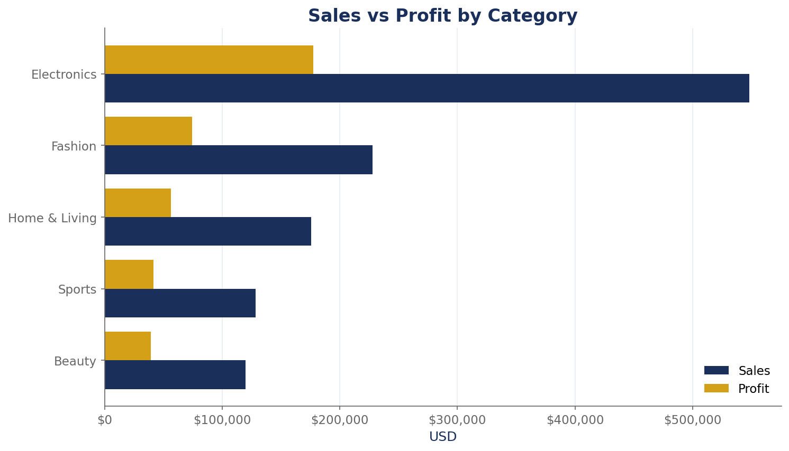
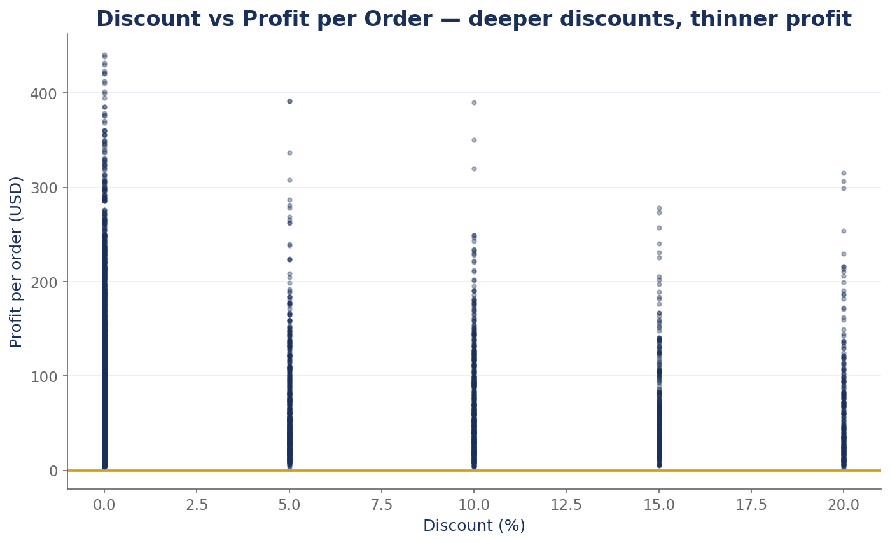
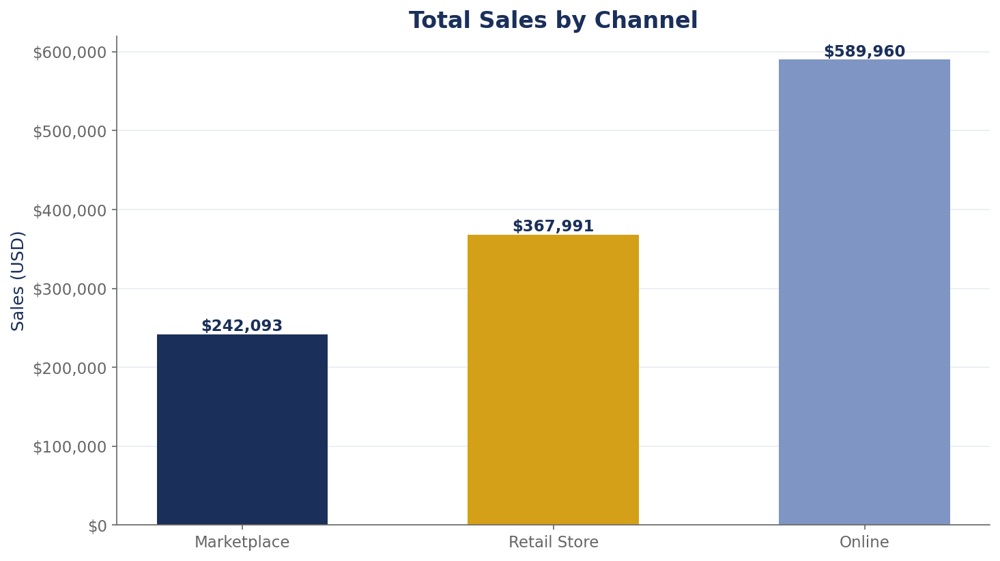
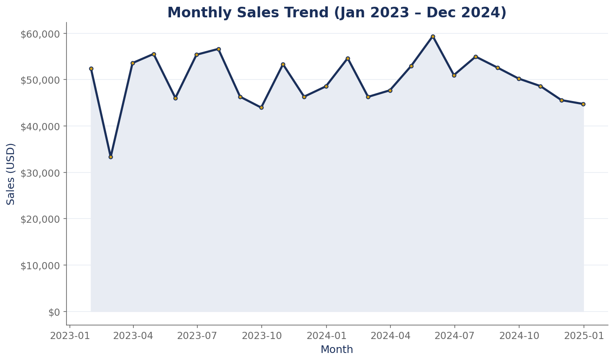

# Retail Sales — Exploratory Data Analysis Report (2023–2024)

*Exploratory Data Analysis Report — full statistical summary, charts, and 5 business insights with recommendations, written for non-technical readers.*

---

## 1. Dataset Overview

This report analyzes **5,000 retail orders** placed between **January 2023 and December 2024**. Each order record contains 12 fields: Order ID, date, product category, product name, region, sales channel, customer segment, quantity, unit price, discount, sales, and profit.

| Metric | Value |
|---|---|
| Orders analyzed | 5,000 |
| Time period | Jan 2023 – Dec 2024 (24 months) |
| Total sales | **$1,200,045** |
| Total profit | **$388,633** |
| Overall profit margin | **32.4%** |
| Product categories | 5 (Electronics, Fashion, Home & Living, Sports, Beauty) |
| Regions | 5 (North, South, East, West, Central) |
| Sales channels | 3 (Online, Retail Store, Marketplace) |
| Customer segments | 3 (Consumer, Corporate, Home Office) |

> **Note:** The underlying dataset is synthetic/sample data created for demonstration and portfolio purposes. It is internally consistent (sales always equals quantity × price × (1 − discount)), but the patterns describe the sample, not a real company.

---

## 2. Data Quality Notes

Before analyzing, the data was checked for common problems — and it passed every check:

- **Missing values:** none — all 5,000 rows are complete across all 12 columns.
- **Duplicates:** no duplicate Order IDs and no duplicate rows.
- **Loss-making orders:** zero — every one of the 5,000 orders was profitable.
- **Plausible ranges:** discounts run 0%–20%, quantities 1–5 units, unit prices $10–$220.
- **Internal consistency:** in all 5,000 rows, Sales = Quantity × UnitPrice × (1 − Discount) exactly, confirming clean, trustworthy data.

The dataset is complete, consistent, and ready for analysis.

---

## 3. Descriptive Statistics

The table below summarizes the key numeric fields:

| Statistic | Sales ($) | Profit ($) | Quantity | Unit Price ($) | Discount |
|---|---|---|---|---|---|
| **Mean** | 240.01 | 77.73 | 3.03 | 81.92 | 0.03 |
| **Median** | 184.10 | 57.68 | 3.00 | 73.63 | 0.00 |
| **Std. deviation** | 194.83 | 66.61 | 1.42 | 48.78 | 0.06 |
| **Minimum** | 10.00 | 2.13 | 1 | 10.02 | 0.00 |
| **Maximum** | 1,099.95 | 440.95 | 5 | 219.99 | 0.20 |

What this tells us: the typical order is worth **about $240** (median $184, meaning half of all orders are below $184). Most orders carry **no discount at all** (median discount 0%), and discounts are used sparingly overall (average just 3%).

*Most orders cluster below $400; a long tail of larger orders (up to $1,100) pulls the average above the median.*

---

## 4. Business Insights

### Insight 1 — Electronics is the engine: $548K of $1.2M in sales (45.7%)

Electronics generated **$548,161** in sales from 1,510 orders — nearly half of all revenue, more than double the next category (Fashion at $228,038). Its 32.4% margin is right at the company average, so it earns its share honestly. The five best-selling products in the entire dataset are **all** electronics: Webcam ($114,496), Bluetooth Speaker ($113,711), USB-C Hub ($108,303), Wireless Headphones ($107,373), and Smart Watch ($104,278).

### Insight 2 — Deep discounts quietly eat profit per order

Orders with **no discount** average **$80.83** profit, but orders with a **16–20% discount** average only **$64.43** — **17.1% less profit per order**. Discount and profit are negatively correlated (−0.069): the more discount given, the thinner the profit. Nearly 70% of orders (3,490 of 5,000) already sell at full price, so discounting is the exception — but the 244 deeply-discounted orders give away the most margin.

### Insight 3 — Online is the powerhouse channel: 48.9% of orders, 49.2% of sales

Online brought in **2,445 orders** and **$589,960** in sales — roughly half the business on its own, with the highest channel margin (32.6%). Retail Store adds $367,991 (1,525 orders) and Marketplace $242,093 (1,030 orders). Average order values are close ($241 online/store, $235 marketplace), so the difference is volume, not ticket size.

### Insight 4 — Geography barely matters: every region performs within 3.6% of each other

Regional sales run from **$235,975** (Central) to **$244,790** (South) — a spread of only 3.6% — and all five regions post margins between 32.3% and 32.5%. No region is a star or a laggard. This means regional expansion or regional ad budgets are unlikely to move the needle; the growth levers are elsewhere.

### Insight 5 — Sales were flat year-over-year: H1 2023 vs H2 2024 grew just +0.2%

Monthly sales swing between **$33,317** (Feb 2023) and **$59,384** (May 2024) with no clear upward trend. Comparing the first half of 2023 ($296,256) with the second half of 2024 ($296,756) shows growth of only **+0.2%** — essentially flat. The business is stable but not growing; it needs a deliberate growth push (Insights 1–3 show where).

---

## 5. Recommendations

1. **Protect and spotlight the electronics heroes.** The Webcam, Bluetooth Speaker, and USB-C Hub drive nearly half of revenue — guarantee stock availability, feature them on the homepage, and bundle accessories around them.
2. **Cap discounts at 15%.** The 16–20% band cuts per-order profit by 17%. Require approval for anything above 15% and test whether those orders convert at lower discounts anyway.
3. **Invest marketing where it already works: Online.** Online delivers half the business at the best margin — shift a share of retail/marketplace ad spend there.
4. **Stop overthinking regional strategy.** With all regions within 3.6% of each other, keep regional spending even and reallocate that analytical effort toward product and channel decisions.
5. **Restart growth.** Sales were flat (+0.2%) over 18 months. Combine recommendations 1–3 into a single growth campaign: hero electronics, promoted online, without deep discounts.

---

## Appendix — How this report was produced

All statistics and charts were generated from the raw data by the script `eda_analysis.py` (Python: pandas, NumPy, matplotlib — navy/gold chart style). No numbers were hand-written; every figure in this report is computed directly from the dataset.
