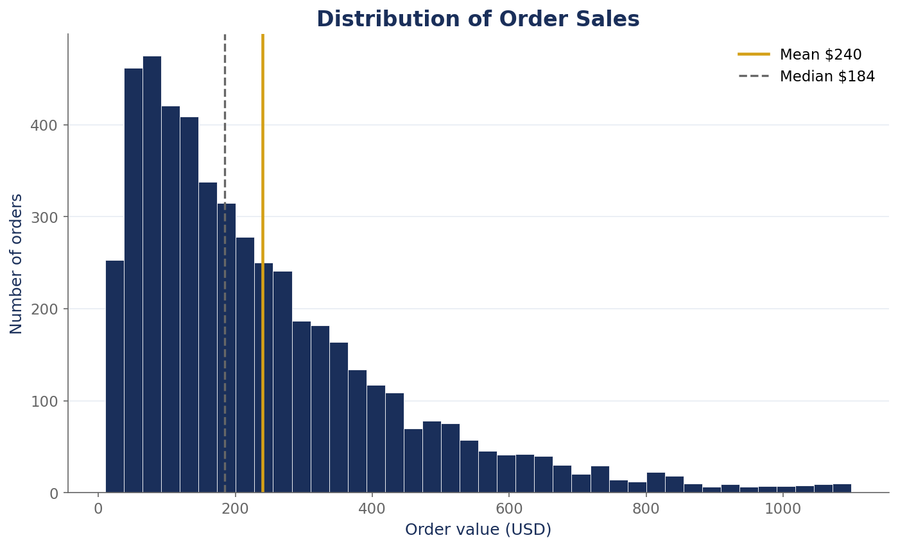

# Retail Sales — Exploratory Data Analysis

A full exploratory data analysis of 5,000 retail orders (2023–2024): statistical summary, 5 charts, and 5 numbered business insights with recommendations — written for non-technical readers.

**📄 Read the full report: [EDA_Report.md](EDA_Report.md)**

## Tools used
Python · pandas · NumPy · matplotlib

## Skills demonstrated
- Data cleaning & data-quality validation (missing values, duplicates, consistency checks)
- Descriptive statistics (mean, median, standard deviation)
- Grouped & time-series analysis (by category, channel, region, segment, month)
- Data visualization (histograms, trend lines, grouped bar charts, scatter plots)
- Translating numbers into business insights & recommendations

## Key findings (from [EDA_Report.md](EDA_Report.md))
- Electronics drives 45.7% of revenue ($548K of $1.2M)
- Deep discounts (16–20%) cut per-order profit by 17.1%
- Online is the powerhouse channel (49.2% of sales)
- Sales were flat year-over-year (+0.2%) — the business needs a growth push

> Note: the dataset (`../retail_sales.csv`) is synthetic/sample data for demonstration purposes.
